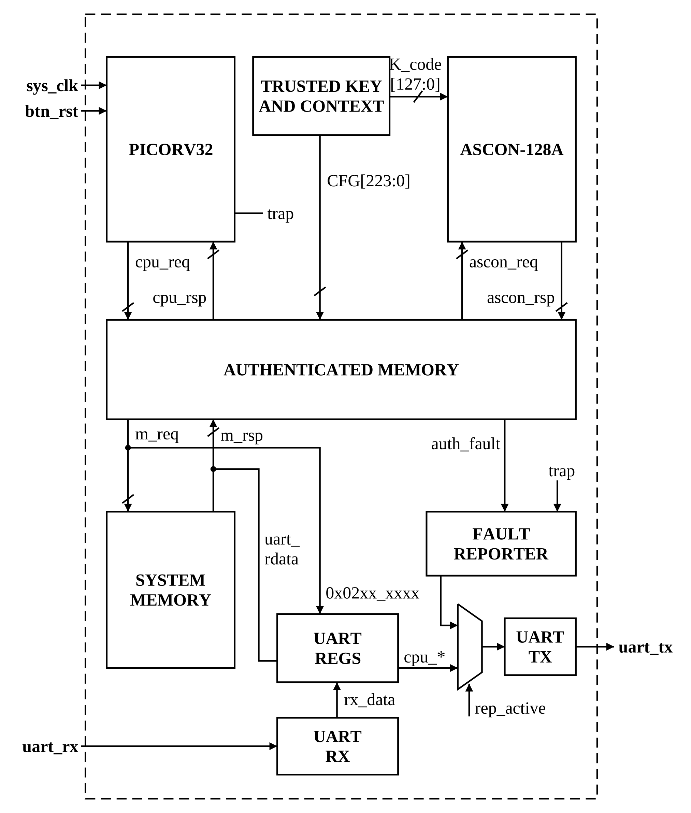

# Instruction Authorization Integrity trên RISC-V/FPGA

Nghiên cứu **xác thực lệnh (instruction integrity)** cho lõi RISC-V trên FPGA, theo hướng Moving Target Defense.

> **Trạng thái:** đã có **baseline static authenticated execution**.
> đang nghiên cứu triển khai giao thức **lazy evolution** (prepare → publish → retire).

## Ý tưởng

Integrity truyền thống chỉ kiểm tra lệnh hoặc khối mã có bị sửa hay không. Ở đây, mỗi vùng mã (region) có một
**protection version** riêng và được chuyển sang version mới độc lập. Sau khi một vùng được cập nhật, tag/context
của version cũ **không còn được dùng cho các lần fetch mới**.

Ba câu hỏi nghiên cứu:

1. Cần xác thực những gì để một lệnh được xem là hợp lệ **tại đúng địa chỉ, firmware, domain và version**?
2. Đổi protection version có thật sự làm giảm khả năng **replay, transplantation hoặc reuse** artifact mà attacker đã thu thập không?
3. Có thể **migrate integrity metadata theo từng vùng** khi chương trình đang chạy mà không tạo trạng thái authorization lẫn lộn hoặc cũ (mixed/stale) không?

## Kiến trúc hiện tại (baseline static)

Mỗi block lệnh (`G = 4` word) được gắn một tag 128 bit tính bằng **Ascon-128A** từ key, nonce `{PROGRAM_ID, IMAGE_ID}`,
nội dung và địa chỉ block. Bộ xác thực nằm ở wrapper bộ nhớ ngoài core, nên không cần sửa PicoRV32.



Khi CPU fetch lệnh, `authenticated_memory` đọc block và tag, nhờ Ascon tính lại tag rồi so sánh.
Khớp thì cho thực thi, không khớp thì báo `auth_fault` và CPU trap. Lỗi được in ra UART.

Baseline này là **đối chứng bắt buộc**, không phải Moving Target Defense.

## Tiến độ

| Hạng mục | Trạng thái |
| --- | --- |
| Static authenticated execution (PicoRV32 + Ascon + wrapper) | Đã hiện thực trên Tang Nano 20K |
| Ký firmware (`auth_signer.py`) và nạp hex qua `$readmemh` | Có |
| Kịch bản tấn công: sửa lệnh, sửa tag, đổi block, sai key, image cũ, ghi vào code, nhảy vào data | Có kịch bản và testbench |
| Báo cáo tiến độ baseline | `docs/report/Bao_cao_tien_do_baseline.pdf` |
| Region/version table | Chưa |
| Lazy prepare → publish → retire | Chưa |
| Assertion cho coherent authorization, stale-state rejection | Chưa |
| Đo LUT/FF/BRAM/Fmax, overhead runtime của baseline | Đang thực hiện |
| So sánh static với lazy dynamic; core thứ hai | Chưa |

## Cấu trúc repo

```
.
├── design/
│   ├── hw/
│   │   ├── rtl/            RTL: PicoRV32, Ascon, authenticated memory, UART
│   │   ├── constraints/    Gán chân (.cst) và thời gian (.sdc) cho Tang Nano 20K
│   │   └── sim/            Testbench mô phỏng
│   ├── sw/
│   │   ├── firm/           Firmware C/asm, linker script, auth_signer.py
│   │   └── toolchain/      Hướng dẫn và script cài xPack RISC-V GCC
│   ├── verification/       Kịch bản kiểm thử, mô hình tham chiếu
│   └── report/             Báo cáo tài nguyên/thời gian từ Gowin
└── docs/
    ├── guide/              Hướng dẫn
    ├── report/             Báo cáo
    ├── references/         Tài liệu tham khảo và ghi chú
    ├── pdf/                PDF các paper
    └── resources/          Sơ đồ (drawio) và hình ảnh
```

Mỗi thư mục chính có `README.md` riêng:
[`rtl`](design/hw/rtl/README.md) ·
[`constraints`](design/hw/constraints/README.md) ·
[`firm`](design/sw/firm/README.md) ·
[`toolchain`](design/sw/toolchain/README.md)

## Bắt đầu nhanh

Yêu cầu: Windows, Python 3, [Gowin EDA](https://www.gowinsemi.com/), board **Sipeed Tang Nano 20K**
và module USB-UART **CP2102** (chi tiết nối dây ở [`constraints`](design/hw/constraints/README.md)).

1. **Cài toolchain** (xPack RISC-V GCC 15.2.0-1):
   ```powershell
   cd design\sw\toolchain
   powershell -ExecutionPolicy Bypass -File setup.ps1
   . .\env.ps1
   ```
2. **Biên dịch và ký firmware** theo [`design/sw/firm/README.md`](design/sw/firm/README.md),
   kết quả là `code.hex`, `tag.hex`, `data.hex` trong `design/sw/firm/active/`.
3. **Tổng hợp và nạp** bằng Gowin: top module `tangnano20k_top`, thêm file `.cst` và `.sdc`,
   sau đó Clean → Synthesize → Place & Route → Program (xem [`rtl`](design/hw/rtl/README.md)).
4. **Quan sát qua UART** (115200 baud, 8N1) trên cổng COM của CP2102.

> Các tham số ký (`G`, `T`, key, `PROGRAM_ID`, `IMAGE_ID`) phải trùng giữa `auth_signer.py` và `tangnano20k_top.v`.

## Tài liệu tham khảo chính

Các paper về instruction/code integrity và authenticated execution nằm trong `docs/pdf/`:
CIFER, Cryptographic Instruction Chaining, SABLE, Morpheus, Morpheus II, Proteus và bài Ascon v1.2.


## Phần mềm bên thứ ba

| Thành phần | Nguồn | License |
| --- | --- | --- |
| PicoRV32 (`design/hw/rtl/picorv32.v`) | Claire Xenia Wolf, YosysHQ | ISC |
| xPack RISC-V GCC | xPack Dev Tools | |

## License
