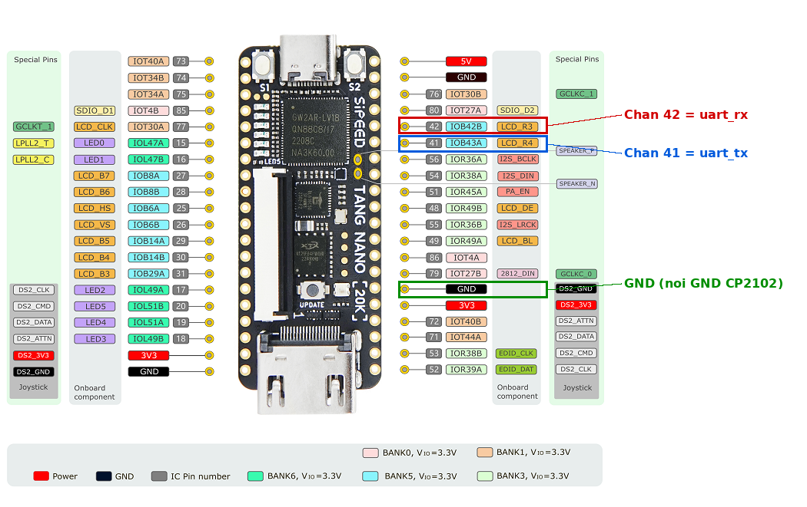
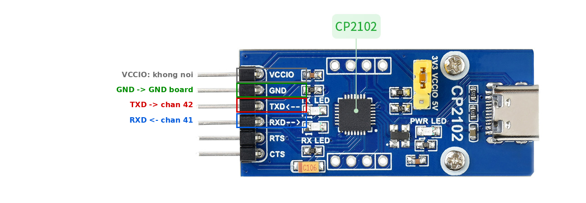

# Constraints: Tang Nano 20K

Rang buoc vat ly (chan) va thoi gian cho top-level `tangnano20k_top`
(xem [`../rtl/README.md`](../rtl/README.md)).

| File | Noi dung |
| --- | --- |
| `tangnano20k.cst` | Gan chan, muc dien ap (physical constraints) |
| `tangnano20k.sdc` | Rang buoc thoi gian (xung 27 MHz) |
| `images/` | Hinh minh hoa chan board va module CP2102 |

- Board: Sipeed Tang Nano 20K, FPGA GW2AR-LV18QN88C8/I7.
- Dien ap IO: LVCMOS33 (3.3 V).

## Bang gan chan

| Cong trong RTL | Chan | Huong | Ket noi vat ly |
| --- | --- | --- | --- |
| `sys_clk` | 4 | vao | Thach anh 27 MHz tren board (khong ra header) |
| `btn_rst` | 88 | vao | Nut S1 (`MODE0_KEY1`) tren board, reset |
| `uart_tx` | 41 | ra | Noi vao **RXD** cua module CP2102 |
| `uart_rx` | 42 | vao | Noi vao **TXD** cua module CP2102 |

Chan 41 (`IOB43A`) va 42 (`IOB42B`) nam o hang header ben phai board (nhin tu cong USB-C tren).

## Day noi voi module CP2102

UART di cheo: TX cua ben nay vao RX cua ben kia.

| Tang Nano 20K | CP2102 |
| --- | --- |
| Chan 41 (`uart_tx`) | RXD |
| Chan 42 (`uart_rx`) | TXD |
| GND | GND |
| (khong noi) | VCCIO |

Luu y:
- **Khong noi 3V3/5V** cua board sang module. Jumper tren CP2102 dat o **3V3** de muc logic 3.3 V.
- Phai noi **GND chung** giua hai ben.
- Cam module vao may tinh, mo terminal (115200 baud, 8N1) tren cong COM cua CP2102.

### Hinh chan Tang Nano 20K

Chan 42 (do), chan 41 (xanh duong) va GND (xanh la) duoc khoanh tren so do chan:



Anh goc chua danh dau: [`images/tangnano20k_pinout.png`](images/tangnano20k_pinout.png).

### Hinh module CP2102

Cac chan header cua module, danh dau cach noi:



Anh goc chua danh dau: [`images/cp2102_module.png`](images/cp2102_module.png).

> Hinh lay tu tai lieu cua nha san xuat board / module. Kiem tra ban quyen va ghi nguon truoc khi
> dua repo len cong khai, hoac thay bang hinh tu chup / tu ve.

## Giai thich `tangnano20k.cst`

```
IO_LOC  "sys_clk" 4;    IO_PORT "sys_clk" IO_TYPE=LVCMOS33 PULL_MODE=UP;
IO_LOC  "btn_rst" 88;   IO_PORT "btn_rst" IO_TYPE=LVCMOS33;
IO_LOC  "uart_tx" 41;   IO_PORT "uart_tx" IO_TYPE=LVCMOS33 PULL_MODE=UP;
IO_LOC  "uart_rx" 42;   IO_PORT "uart_rx" IO_TYPE=LVCMOS33 PULL_MODE=UP;
```

- `IO_LOC` gan ten cong trong RTL vao chan vat ly.
- `IO_TYPE=LVCMOS33` chon chuan 3.3 V; `PULL_MODE=UP` bat tro keo len.
- Chan 87 va 88 la chan **MODE** (da chuc nang). Neu Place & Route bao loi, vao
  Project -> Configuration -> Dual-Purpose Pin va chon **Use MODE as regular IO**.
- Muon dung cong USB-UART co san tren board thay vi module CP2102 roi: doi `uart_tx` 41 -> 69 va `uart_rx` 42 -> 70.

## Giai thich `tangnano20k.sdc`

```
create_clock -name sys_clk -period 37.037 -waveform {0 18.518} [get_ports {sys_clk}]
set_false_path -from [get_ports {btn_rst}]
set_false_path -from [get_ports {uart_rx}]
```

- Xung `sys_clk` 27 MHz: chu ky 37.037 ns, duty 50 %.
- `btn_rst` va `uart_rx` la tin hieu bat dong bo tu ben ngoai, nen khong phan tich thoi gian
  tu cac cong nay (false path). Trong RTL, hai tin hieu nay deu duoc dong bo vao xung `sys_clk`.

## Them vao du an Gowin

1. Them `tangnano20k.cst` va `tangnano20k.sdc` vao du an (Project -> Add files, hoac
   chuot phai Physical Constraints / Timing Constraints).
2. Dat top module la `tangnano20k_top`.
3. Neu doi ten cong trong RTL, sua ten tuong ung trong `.cst` va `.sdc`.
4. Synthesize -> Place & Route -> Program.
